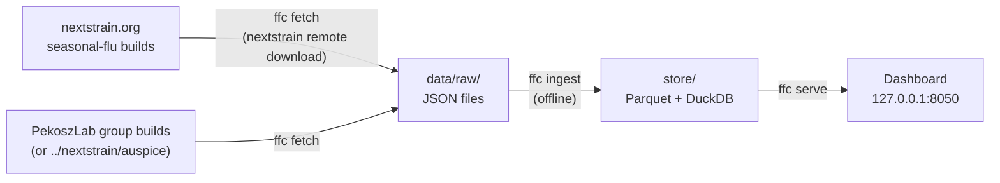

# Flu Frequency Compare 🦠

A dashboard that answers one question:

> **What is the difference in clade, subclade, or genotype frequency between our
> JHH local surveillance and Nextstrain global surveillance?**

It reads **only pre-built Nextstrain/Auspice JSON files**: the JHH builds from the
[Pekosz Lab nextstrain pipeline](https://github.com/Pekosz-Lab/nextstrain) and
the public Nextstrain seasonal-flu builds. This is a separate app. It never
changes the pipeline repository and never uploads anything.

It comes in two forms that share one interface:

| | **Public website** (GitHub Pages) | **Local app** (`ffc start`) |
|---|---|---|
| JHH builds | public builds only (PekoszLab-Public group) | private PekoszLab group (your Nextstrain login), public group, or a local copy |
| Runs | in the visitor's browser; data fetched live from nextstrain.org | on your computer; dashboard on 127.0.0.1 only |
| Private builds | **never accessed** | yes, they stay on your computer |
| Install | nothing | conda environment |



> [!IMPORTANT]
> Frequencies are **relative frequencies of taxa in the supplied builds**. They are
> not prevalence. JHH builds include every sequence in the build; seasonal-flu
> builds are downsampled by their own pipeline. The dashboard and every export
> say so.

## Install (once)

Needs [conda](https://docs.conda.io/projects/conda/en/latest/user-guide/install/index.html). Works on macOS and WSL.

```shell
cd flu-freq-compare
conda env create -f environment.yml
conda activate flu-freq-compare
git config core.hooksPath .githooks     # blocks accidental commits of data
```

Try it with invented data first:

```shell
ffc demo                                # writes SYNTHETIC builds, builds store-demo/
ffc --store store-demo serve --open     # opens http://127.0.0.1:8050
```

## Run it with private builds: `ffc start`

The guided setup checks your setup, asks where the JHH builds should come from,
signs you in with Nextstrain's own `nextstrain login` (browser sign-in; the app
never sees your password), checks that your account belongs to the private
PekoszLab group, downloads and processes the builds, and opens the dashboard.
Without group access it offers to continue with the public builds instead.

```shell
conda activate flu-freq-compare
ffc start                               # answer the questions, or press Enter for the defaults
ffc start --source public --yes         # no questions: public builds, all defaults
```

The website's "Private builds: run locally" page has the same instructions for
new lab members.

## Use with real builds (step by step)

```shell
nextstrain login                        # only needed for the private PekoszLab group
ffc fetch                               # download JSONs with `nextstrain remote download`
ffc ingest                              # parse them into store/ (no network)
ffc serve --open                        # dashboard at http://127.0.0.1:8050
```

`ffc update` runs fetch then ingest. Re-running is cheap: unchanged builds are
skipped (checked by SHA-256 of each JSON).

What gets downloaded is set in [`config/fetch.yaml`](config/fetch.yaml):

| Source | Remote path | Notes |
|---|---|---|
| Global | `nextstrain.org/flu/seasonal/{h1n1pdm,h3n2,vic}/{ha,na}/{6m,2y,3y,6y,12y}` | Resolutions that don't exist are reported and skipped |
| Local (default) | `nextstrain.org/groups/PekoszLab/seasonal/{h1n1,h3n2,vic}/{ha,na}` | Reviewed builds; needs `nextstrain login` |
| Local (alternative) | `../nextstrain/auspice/{h1n1,h3n2,vic}/{ha,na}.json` | Set `local.mode: copy`. Files are copied, never modified |

Every `ffc fetch` also refreshes the **national clade/subclade colours** from the
seasonal-flu datasets (Nextstrain re-assigns them as subclades emerge), even with
`--only local`. They are saved to `data/colors/nextstrain_colors.json` and applied
by the next `ffc ingest`, so the dashboard matches nextstrain.org: official colours
for listed subclades, Auspice's grey for unlisted ones, and Auspice's default
palette for `clade_membership` (which has no official scale).

`ffc fetch --dry-run` prints the commands without running them.
`ffc inspect` lists each build's colourings, filters and genes (never data values),
useful to check the `grouping_fields` in [`config/settings.yaml`](config/settings.yaml).

You can also skip `ffc fetch` and list JSONs by hand: copy
[`config/manifest.example.yaml`](config/manifest.example.yaml) to `config/manifest.yaml`.

## The dashboard

- **Left panel:** dataset (subtype, segment), the two builds to compare (JHH local, and
  the Nextstrain global resolution 6m … 12y; click a build's line for its details),
  colour by clade / subclade / genotype (genotype adds gene + positions), and
  **Display options** (Top-N, palette, shared or native time axis, projections).
- **Filter data:** one search box above the chart, as in Auspice. Type a value (a region,
  country, subclade…) or an attribute name and pick from the list; each choice becomes a
  chip. Values recorded in both builds (pairings set in `config/settings.yaml` →
  `shared_filters`) are applied to **both** datasets; the chip's scope menu switches a
  filter to the JHH local or Nextstrain global build only. Bars beside the box show how
  many tips of each build are included.
- **Dates:** by default the view covers exactly the dates where **both** datasets have
  data (after filters), so the two panels line up. Presets: Overlap, last 6/12/24 months
  of the overlap, All; or drag the range brush / type exact dates. The snapshot slider
  (with play) steps through shared timepoints.
- **Main panel:** JHH local frequencies above global frequencies on a shared time axis,
  or an overlay, or the local − global difference in percentage points.
- **Snapshot table** (click a column to sort), **Provenance & methods** (collapsed; each
  value tagged JSON / manifest / derived / missing), and **Download** (PNG, SVG, PDF, CSV,
  TSV, JSON, HTML report). Every figure carries build labels, dates, filters and the
  caveat footnote.

## The public website

`frontend/web/` holds three pages: a homepage, the analysis (the same dashboard,
running in the browser), and the run-locally instructions. The analysis
fetches **public** datasets live from nextstrain.org (`flu/seasonal/...` and
`groups/PekoszLab-Public/seasonal-flu/...`, the paths written by the nextstrain
repo's `scripts/nextstrain_upload.py --public`) and processes them with
`frontend/src/engine/`, a TypeScript port of the Python engine. A test checks
that both engines give identical results.

The website can never touch private builds:
- it only knows public dataset paths (`scripts/export_web_config.py` refuses to write a private path);
- every fetch is checked against those public paths and sent without cookies or credentials;
- the page's Content-Security-Policy only allows requests to nextstrain.org;
- the build fails if any private-group path or local-app API call appears in it (`frontend/scripts/check-site.mjs`);
- nextstrain.org itself refuses logged-in requests from other websites.

**Publishing:** push this repository to GitHub, then in the repository's
Settings → Pages set *Source* to **GitHub Actions**. `.github/workflows/website.yml`
builds and deploys the site on every push to `main`, at
`https://<owner>.github.io/<repository>/`. The site contains no data, so
there is nothing to update when new builds are published: visitors always see the
current public builds. PDF export is available in the local app only.

## Data protection

The JSONs contain unpublished JHH data and GISAID-derived data. `data/`, `store/`,
`store-demo/`, `*.parquet`, `*.duckdb` and `config/manifest.yaml` are git-ignored and
the pre-commit hook blocks them. The server listens on `127.0.0.1` only. Exports
contain aggregated frequencies, not strain names.

## Developing

```shell
npm run build:web                        # (in frontend/) builds the website into site-dist/
python scripts/export_web_config.py      # after editing config/*.yaml or ffc/constants.py
pytest                                   # backend + ingestion tests (synthetic data)
cd frontend && npm install && npm run dev  # UI with hot reload (proxies to ffc serve)
npm run build                            # rebuilds frontend/dist (committed, so users need no Node)
ffc demo && ffc --store store-demo serve # then: npm run test:e2e  (website test: serve site-dist at
                                         #   http://127.0.0.1:8090/flu-freq-compare/, e.g. via python -m http.server)
```

Design, schema, API and roadmap: [`docs/DESIGN.md`](docs/DESIGN.md).
Rules for AI coding agents: [`AGENTS.md`](AGENTS.md).
