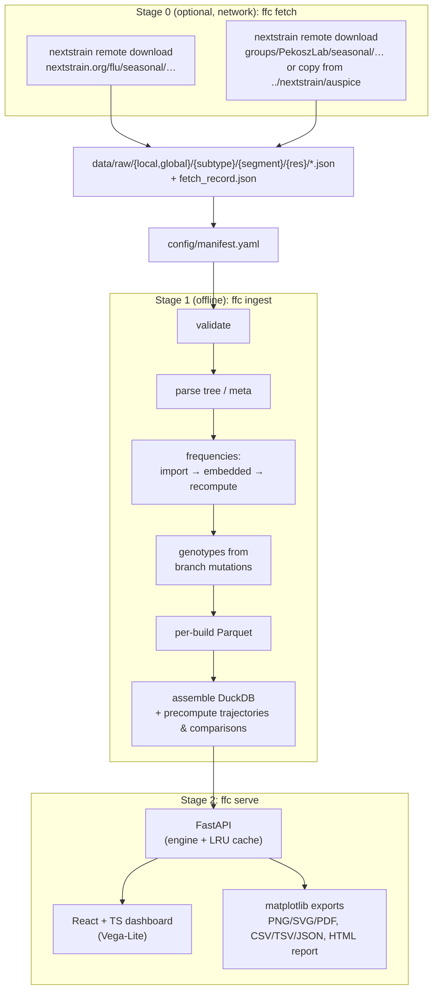
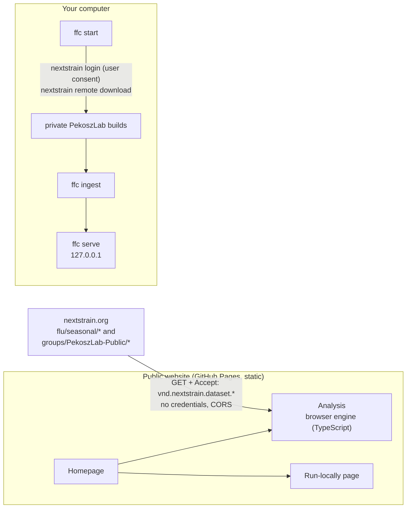

# Flu Frequency Compare: design

Status: v0.1.0. Phase 1 and most of Phase 2 are implemented; see §15.

**Question answered:** what is the difference in clade, subclade or genotype
*relative* frequency between JHH local surveillance builds and Nextstrain
seasonal-flu global builds?

**Input constraint:** only pre-built Nextstrain/Auspice JSON files. The only
network step is `ffc fetch`, which runs `nextstrain remote download` to put those
JSON files on disk. It is separate from ingestion, optional (a hand-written manifest
works the same way), and download-only. Ingestion and the dashboard make no network
calls (enforced by a test that disables sockets during ingestion).

---

## 1. Architecture overview



- **Stage 0** writes JSONs and provenance (`remote`, `fetched_at`) into the manifest.
- **Stage 1** parses each build once into normalised Parquet tables, then loads them
  into one DuckDB file and precomputes the common views (unfiltered clade and subclade
  trajectories for every build; comparisons at shared timepoints for every compatible
  local × global pair).
- **Stage 2** never touches JSON. Common views come from precomputed tables; filtered
  and genotype views aggregate stored per-tip frequency weights in DuckDB (tens of ms)
  and are cached (LRU, keyed by the full request). The store is re-opened automatically
  when `ffc ingest` rewrites it.

### Stack and deviations from the preferred stack

| Layer | Used | Note |
|---|---|---|
| Frontend | React 18 + TypeScript + Vite | as preferred; `frontend/dist` is committed so lab users need no Node |
| Interactive charts | Vega-Lite (vega-embed) | the grammar Altair writes, so any figure can be saved as a spec and reopened in Python (`alt.Chart.from_dict`); linked hover across panels, legend/click highlighting; ~1 MB instead of Plotly's ~4.5 MB |
| Publication figures | matplotlib (server-side) | one renderer for PNG/SVG/PDF with the full caption block; browser-side PDF export is unreliable |
| Backend | FastAPI | as preferred |
| Processing | Python + pandas + NumPy | pandas instead of Polars: smaller dependency set; volumes are small (≤ ~10⁶ rows) |
| Storage | Parquet + DuckDB | as preferred |
| Deployment | **conda environment (primary)**, Docker/Compose (optional) | the lab is moving off Docker and must run on macOS and WSL |
| Config | YAML | as preferred |
| Tests | pytest, Playwright | as preferred |

## 2. Repository structure

```
flu-freq-compare/
├── README.md, AGENTS.md, environment.yml, pyproject.toml, docker-compose.yml
├── config/
│   ├── settings.yaml               enabled segments, grouping fields, filters, KDE params
│   ├── fetch.yaml                  what `ffc fetch` downloads
│   ├── taxon_harmonization.yaml    explicit, versioned relabelling (empty by default)
│   ├── manifest.example.yaml       manifest specification by example
│   └── manifest.yaml               (git-ignored) written by `ffc fetch` or by hand
├── ffc/
│   ├── cli.py         fetch | ingest | update | serve | inspect | demo
│   ├── fetch.py       `nextstrain remote download` wrapper (stage 0)
│   ├── config.py      settings/manifest/harmonization loading and validation
│   ├── validate.py    Auspice v2 + tip-frequency validation
│   ├── parse_auspice.py, genotypes.py, frequencies.py, dates.py
│   ├── ingest.py      stage 1
│   ├── schema.py      normalised schema
│   ├── engine.py      all queries: frequencies, alignment, snapshot, colours, provenance
│   ├── api.py         FastAPI (stage 2)
│   ├── exports.py     figures, tables, report
│   ├── constants.py   caveat wording, vocabularies
│   └── demo.py        synthetic builds for demos/tests
├── frontend/          React + TS source, e2e tests, built dist/
├── tests/             pytest suite (synthetic data only)
├── docker/Dockerfile
├── data/   (git-ignored) raw JSONs        store/ (git-ignored) Parquet + DuckDB
└── .githooks/pre-commit   blocks data from being committed
```

## 3. Input JSON manifest specification

YAML, `config/manifest.yaml` (see `config/manifest.example.yaml`).

| Field | Required | Meaning |
|---|---|---|
| `id` | yes | unique build id |
| `source_type` | yes | `local` or `global` |
| `subtype` | yes | `h1n1pdm`, `h3n2`, `vic` (aliases H1, H1N1, H3, B/Vic, …) |
| `segment` | yes | HA, NA (PB2…NS, GENOME understood; exposed when enabled in settings) |
| `auspice_json` | yes | path to the Auspice v2 dataset JSON |
| `frequencies_json` | no | augur tip-frequencies JSON; auto-detected as `<stem>_tip-frequencies.json` |
| `root_sequence_json` | no | root-sequence sidecar; auto-detected as `<stem>_root-sequence.json` |
| `label`, `organization` | no | display |
| `resolution` | no | e.g. `6m`, `2y`, `12y` (global selector) |
| `remote`, `fetched_at` | no | provenance written by `ffc fetch` |
| `build_date` | no | the JSON only carries `meta.updated`; supply here if known |
| `downsampling_description` | no | overrides the default local/global statement |
| `active` | no | default true |
| `synthetic` | no | marks demo data (red banner) |
| `managed_by: fetch` | no | entry is rewritten by `ffc fetch`; others are preserved |
| anything else | no | kept as manifest metadata |

Every value shown in the UI is tagged by origin: **JSON** (extracted from the source
file), **manifest** (deployment-supplied), **derived** (computed from the JSON), or
**missing** (“Not available in source JSON” for JSON fields; “Not supplied in manifest”
for manifest fields). Nothing is inferred to fill a gap.

## 4. JSON validation strategy

Errors skip the build (others still ingest); warnings are stored and shown in the
build card and provenance panel.

- **Auspice JSON** — error: `version != "v2"`; no `meta`; no/array `tree`; unnamed or
  duplicate node names; no tips. Warning: missing `meta.updated` / `colorings` /
  `genome_annotations`; tips without `num_date` (excluded from frequencies).
- **Tip-frequencies JSON** — error: no `pivots`, non-numeric or non-increasing pivots,
  vector length ≠ number of pivots, negative values, no entry matching a tip. On error
  the build falls back to embedded data or recomputation (recorded). Warning: entries
  that are not tips (the lab's current files contain internal-node entries; ignored, as
  in Auspice); tips with no entry; `projection_pivot` present (projections hidden by
  default).
- **Manifest** — required fields, unique ids, known subtype/segment/source_type, files
  exist (missing files are reported per build).
- **Change detection** — SHA-256 of each JSON plus manifest entry, settings and app
  version; unchanged builds are reused.

## 5. Auspice/Nextstrain JSON parsing strategy

- Iterative pre-order traversal (no recursion limit on deep trees).
- `node_attrs`: scalar values and `{value: …}` objects are flattened; `num_date.value`
  is the collection date (decimal year, converted with augur's convention
  `year + (doy − 0.5)/days`, inverse uses rounding so 4-decimal pivots stay on their day).
- **Grouping fields** chosen per build from `settings.yaml` candidate lists (first field
  present wins): clade ← `legacy-clade | clade | clade_membership`; subclade ←
  `subclade | proposed_subclade`. The field used is shown in the UI and exports.
  JHH builds use `legacy-clade` and `subclade`.
- **Filters on both datasets** (`Engine.shared_filters`): attribute pairs listed in
  `settings.yaml → shared_filters.pairs` (candidate fields on each side) plus any
  filterable field with the same name in both builds. A pair is offered only if the
  two fields share at least one value; among candidates the pair sharing the most
  values wins. This matters: in seasonal-flu NA builds `subclade` holds NA
  nomenclature and the HA subclade is in `subclade_nextclade_ha`, which is what the
  lab's NA builds call `subclade`; `legacy-clade` (full names) and `clade_membership`
  (short names) share no values for H1N1pdm/H3N2 and are reported as not comparable.
- **Metadata filters**: `meta.filters` ∪ categorical `meta.colorings` ∪ configured
  candidates (region, country, division, location, host, …), minus excluded fields and
  fields with > 400 distinct values. Local and global builds are not assumed to share
  fields; a field present in one build only is shown greyed out in the other's panel.
- **Colours** (`ffc/colors.py`) reproduce what nextstrain.org shows for the selected
  global build, using Auspice's own rules: (1) the official scale for the field (e.g.
  `subclade`), refreshed on **every** `ffc fetch` from the seasonal-flu dataset JSONs
  (merged across resolutions, most recent first) into `data/colors/nextstrain_colors.json`
  and loaded by ingest into `reference_colors`; (2) values in the national tree but not in
  the scale get Auspice's grey ramp (#BDC3C6→#868992, in pre-order of first appearance,
  stored per build in `value_order`); (3) fields with no scale (seasonal-flu
  `clade_membership`) get Auspice's default categorical palette over the alphabetically
  sorted values; (4) values only in the local build use the local JSON's scale (the
  lab's synced `colors.tsv`) or a grey ramp. Values `unknown`, `?`, `unassigned`, … are
  "Not assigned", as in Auspice. A colour-blind-safe palette is available as an option.
- **Genotypes**: `branch_attrs.mutations` per gene (`nuc` + CDSs in
  `meta.genome_annotations`). DFS with undo records keeps the current state; each tip
  stores only states that differ from the root (sparse). Root state: root-sequence
  sidecar if supplied, otherwise the `from` state of the first mutation at that position
  (Auspice's behaviour). A position that never mutates in a build without a root
  sequence has an unknown state: shown as `158?`, flagged, and excluded from
  differences. Gene coordinates are compared between builds and a warning is shown
  when they differ.

## 6. Frequency ingestion and calculation strategy

Priority (recorded per build as `frequency_source`):

1. **Imported** — augur tip-frequencies JSON (`*_tip-frequencies.json`).
2. **Embedded** — a tip-frequencies block inside the Auspice JSON, if present.
3. **Recomputed** — augur-style KDE from tip dates: each tip a mixture of a narrow
   (1/12 y) and wide (3/12 y) Gaussian, 20 % wide, normalised per tip, then across tips;
   monthly pivots from the earliest to the month after the latest tip. Parameters in
   `settings.yaml`.

Aggregation is Auspice's: for taxon *k* at pivot *p* over the included tips *T*,
`f(k,p) = Σ_{t∈T, taxon(t)=k} w(t,p) / Σ_{t∈T} w(t,p)`. Filters change *T* and therefore
renormalise, as Auspice does with "normalize frequencies" on. Local and global are
computed independently.

**Counts.** KDE frequencies have no exact numerator/denominator, so N is reported
separately: the number of tips collected within each pivot's interval (midpoint to
midpoint), per taxon and in total. Labelled as such everywhere.

**Comparison.** `frequency_difference = local − global`, in percentage points.
Positive: higher relative frequency in JHH local surveillance; negative: higher in
Nextstrain global.

**Time alignment ("nearest valid shared timepoint", no interpolation).** The two
sources use different pivot grids: the lab builds have monthly pivots (2nd of each
month) and the seasonal-flu builds weekly pivots (Thursdays). Plotted at their own
dates, the panels' start/end points and transitions do not line up. So both panels
are drawn at one set of **shared timepoints**: the pivots of the build with the
coarser spacing (normally the monthly JHH pivots), extended at the same spacing over
the other build's dates. At each timepoint the other build's value is its nearest
pivot, accepted only within half its own spacing (≤ 3.5 days for weekly pivots);
hover shows the pivot used and its offset. Counts (N) sum each build's pivot
intervals into the timepoint's interval. Differences, the snapshot table, exports and
the precomputed `comparison_observations` all use these timepoints. A "Native
pivots" option shows each build at its own pivots, with a separate time axis for the
local panel.

**Top N / Other.** Taxa ranked by their maximum frequency in either dataset within
the selected range; the rest are summed into "Other", listed under the chart and in
exports.

**Snapshot.** For one shared timepoint, or the mean over all shared timepoints in the range
(taxa absent at a timepoint count as 0); N summed over those timepoints. Taxa present in only
one dataset are kept and badged "local only" / "global only".

## 7. Normalised data schema

DuckDB tables (Parquet per build in `store/parquet/<table>/<build_id>.parquet`):

| Table | Key columns |
|---|---|
| `builds` | build_id, source_type, organization, display_name, subtype, segment, resolution, auspice_json_path, frequencies_json_path, root_sequence_json_path, manifest_metadata, json_metadata, json_title, build_date, updated_date, most_recent_sample_date, min/max_sample_date, total_tip_count, dated_tip_count, tips_with_frequency, downsampling_description, frequency_source (+detail), pivot_count, projection_pivot, clade_field, subclade_field, ingestion_timestamp, source_json_version, source_sha256, remote, fetched_at, synthetic, validation_warnings |
| `tips` | build_id, tip_id, parent_node_id, num_date, collection_date, region, country, division, location, host, clade, subclade, metadata_json, genotype_annotations_json, pivot_bin |
| `tip_attrs` | build_id, tip_id, field, value (long form, drives filters) |
| `pivots` | build_id, pivot_idx, num_date, date, month, is_projection |
| `tip_frequencies` | build_id, tip_id, pivot_idx, weight (sparse) |
| `tip_genotypes` | build_id, tip_id, gene, position, state (non-root only) |
| `genotype_positions` | build_id, gene, position, root_state, n_tips_nonroot, n_states, state_counts |
| `gene_annotations` | build_id, gene, start_pos, end_pos, strand, seq_type, has_mutations |
| `root_sequences` | build_id, gene, sequence |
| `color_scales` | build_id, coloring_key, value, color |
| `value_order` | build_id, coloring_key, value, first_index, n_nodes (clade/subclade values over all nodes, pre-order) |
| `reference_colors` | subtype, segment, coloring_key, value, color, rank, sources, fetched_at (national colours from the latest fetch) |
| `available_metadata_fields` | build_id, field_name, field_title, field_type, allowed_values (JSON with counts), n_tips_with_value, source_location_in_json |
| `frequency_observations` | build_id, source_type, subtype, segment, grouping_type, genotype_definition, taxon_label, pivot_idx, date_bin, num_date, month, is_projection, frequency, numerator_count, denominator_count, filter_context_hash, calculation_method |
| `comparison_observations` | local_build_id, global_build_id, subtype, segment, grouping_type, genotype_definition, taxon_label, date_bin (shared timepoint), local_frequency, global_frequency, difference_percentage_points, local/global numerator and denominator counts, local/global_pivot_date (pivot used), alignment_method, filter_context_hash |
| `store_info` | built_at, app_version, alignment_method |

Extensibility: subtype, segment and resolution are data, not schema. Enabling PB2 is a
one-line settings change. New genotype definitions need no schema change because
genotypes are reconstructed from sparse per-tip states at query time.

## 8. Backend API specification

| Method | Path | Purpose |
|---|---|---|
| GET | `/api/health` | liveness, store path |
| GET | `/api/options` | builds (with dates, counts, downsampling, warnings), valid local/global pairs, enabled segments, caveat text |
| GET | `/api/builds/{id}/fields` | filterable metadata fields with values and counts |
| GET | `/api/shared-filters?local=&global=` | filters that can be applied to both builds: equivalent attribute pairs (fields used, how matched, values with counts in each build), and attributes that are not comparable with the reason |
| GET | `/api/genotype-options?local=&global=` | genes (availability, coordinate match) and positions (variable in local/global) |
| POST | `/api/compare` | everything for one view: per-build trajectories, aligned differences, snapshot table, colours (+ source), shared timepoints, date ranges, harmonization, provenance |
| POST | `/api/export/figure?fmt=png\|svg\|pdf` | publication figure for the current view |
| POST | `/api/export/data?what=trajectories\|comparison\|snapshot\|analysis&fmt=csv\|tsv\|json` | tables with a `#` provenance header; JSON with full settings |
| POST | `/api/export/report` | HTML summary report with embedded SVG |

`/api/compare` body: `local_build_id`, `global_build_id`, `grouping`
(`clade|subclade|genotype`), `genotype {gene, positions[]}`, `local_filters`,
`global_filters` (`{field: [values]}`; OR within a field, AND across fields),
`shared_filters` (`{shared filter id: [values]}`, applied to both builds through their
paired fields and ANDed with the per-build filters), `start`,
`end`, `top_n`, `snapshot {mode: range|point, timepoint}`, `palette`, `include_projection`.
Incompatible pairs (subtype/segment mismatch, wrong source types) return 400.

## 9. Frontend component architecture

```
App                      selection state, debounced/cancellable /api/compare,
│                        keeps start/end on the range the date mode asks for (see below)
├── Sidebar
│   ├── Dataset: subtype + segment buttons (only combinations with a valid pair are enabled)
│   ├── Compare: JHH local (build select if >1) and Nextstrain global (resolution buttons),
│   │            each with a one-line BuildCard (tips, latest sample; details on click)
│   ├── Color by: Clade | Subclade | Genotype (+ gene select, positions, suggested positions)
│   └── Display options (collapsed): Top-N, palette, time axis (shared | native), projections
└── main
    ├── banners (public website, synthetic data)
    ├── chart card: title, view toggle, ExportMenu ("Download")
    │   ├── FilterBar: one Auspice-style search box ("Filter data") with scope-coloured chips,
    │   │   and tips-included bars for each build
    │   ├── FrequencyChart: Vega-Lite spec from `buildSpec` (side by side | by taxon | difference),
    │   │   re-laid-out on resize (legend below the plot and fewer columns under 640 px)
    │   ├── Timeline: DateControls (Overlap | 6/12/24 mo | All, exact dates), range brush with
    │   │   coverage bars, snapshot slider + play
    │   ├── Attribution (labels, JSON dates, fetch and processing timestamps)
    │   └── caveat (full wording from constants.py)
    ├── SnapshotTable (click a header to sort, search, click a row to highlight)
    └── "Provenance & methods" (collapsed): ProvenancePanel + Methodology
```

**Filtering.** Typing in the search box lists matching values across every filterable
attribute, each tagged with its scope (Both / Global / Local) and its tip counts in each
build; typing an attribute name (e.g. "region") offers that attribute's full value list.
With an empty box, the attributes are listed by scope. A value recorded in both builds
(an attribute in `shared_filters`) is offered once, applied to **both** datasets; the
chip's scope menu moves that filter to the local or global build only (values the target
build lacks are dropped). Keyboard: ↑/↓, Enter, Esc (back / close), Backspace on an
empty box removes the last chip. The request body is unchanged (`shared_filters`,
`local_filters`, `global_filters`).

**Chart.** `FrequencyChart.buildSpec` turns a `/api/compare` result into a Vega-Lite spec
(no Plotly). Views: *Side by side* (JHH local stacked areas above Nextstrain global, one
shared crosshair whose tooltip lists every taxon as "local vs global (± pp)" at that
timepoint); *By taxon* (one small panel per taxon, local solid blue, global dashed brown,
the gap between them shaded; independent y scales); *Difference* (local − global in pp,
blue/brown halves labelled above the plot). Clicking a legend entry or a taxon's area or line
highlights it, in sync with the snapshot table; the snapshot timepoint is drawn as a dashed
rule. Download → "Chart spec (Vega-Lite / Altair)" saves the on-screen spec with its data;
the specs validate against Altair 6's schema. Server-side PNG/SVG/PDF exports (matplotlib)
are unchanged; the local app's "By taxon" export uses the server's overlay figure.

**Phones (≤ 760 px).** Settings fold under a "Settings" button above the chart, controls
get larger touch targets, the filter list and table adapt (sticky taxon column), and the
chart re-lays itself out for the width. Wider screens use the desktop layout unchanged.

**Date range.** `Selection.range` is `"overlap"` (default), a number of months, `"all"`
or `"custom"`. For the first three, App compares each response's `date_ranges` with the
dates it asked for and, if they differ, asks again with the target range: `overlap` =
`date_ranges.shared` (dates where both builds have data, after filters), `N` months =
the last N months of the overlap, `all` = no limits. `date_ranges` is computed before the
range restriction, so this settles in one extra request. Dragging the brush or typing a
date switches to `custom`. With no overlap, `overlap` falls back to all dates.

## 10. Dashboard layout (wireframe)

```
┌──────────────────────┬────────────────────────────────────────────────────────────┐
│ DATASET              │ ┌────────────────────────────────────────────────────────┐ │
│ [H1N1pdm|H3N2|B/Vic] │ │ A/H3N2 HA · Subclade        [Side|By taxon|Diff] [Download]
│ [ HA | NA ]          │ │ JHH local vs Nextstrain global 2y                      │ │
│ COMPARE              │ │ [⌕ Both Subclade: J.2 ×  Global Region: N. America × ] │ │
│ ▌JHH local           │ │                                     Local ▬▬▬ 420/420  │ │
│ ▌ 420 tips · to …  ⓘ │ │ JHH local       ▒▒▒▒▒▒▒▒▒▒▒▒▒▒▒▒▒▒▒▒▒▒▒▒▒▒   legend    │ │
│ ▌Nextstrain global   │ │ Nextstrain glob ▒▒▒▒▒▒▒▒▒▒▒▒▒▒▒▒▒▒▒▒▒▒▒▒▒▒             │ │
│ ▌[6m| 2y |12y]       │ │ Dates [Overlap|6 mo|12 mo|24 mo|All]  [start]–[end]    │ │
│ ▌ 900 tips · to … ⓘ  │ │       ═══[▮══════════▮]  local/global/overlap bars     │ │
│ COLOR BY             │ │ Snapshot ▶ ──────●─────                                 │ │
│ [Clade|Subclade|Geno]│ │ Local … updated … · Global … fetched … · caveat         │ │
│ ▸ Display options    │ └────────────────────────────────────────────────────────┘ │
│                      │ Snapshot table                                             │
│                      │ ▸ Provenance & methods                                     │
└──────────────────────┴────────────────────────────────────────────────────────────┘
```

## 11. Example user workflows

1. **Weekly meeting figure.** `ffc update` → `ffc serve --open` → H3N2, HA, Subclade,
   global 2y (the default view already covers the dates both builds share) → Download → PDF.
   The PDF carries build dates and caveats.
2. **Is a subclade over-represented locally?** Difference view; the snapshot table is
   sorted by local − global (largest local enrichment first); click a row to highlight it.
3. **Antigenic site check.** Color by Genotype → HA1 → click suggested positions (e.g.
   158, 189). Genes whose coordinates differ between builds are flagged.
4. **Like-for-like region.** Filter box → type "North America" → pick Region (Global);
   type "good" → pick QC status (Local). Counts and chips update; both filters appear in
   exports.
5. **New season.** Fetch, ingest; unchanged builds are skipped; build cards show the
   new `updated` and fetch dates; projections stay hidden unless toggled.

## 12. Export design

| Export | Content |
|---|---|
| PNG (300 dpi), SVG (editable text), PDF | current view; title; subtype, segment, grouping, genotype definition, date range; local and global build labels, JSON updated date, latest sample, tips included/total, frequency source, filters; processing, refresh and generation timestamps; harmonization and "Other" notes; default footnote |
| CSV / TSV trajectories | dataset, build_id, taxon, shared timepoint, pivot date used, offset (days), frequency, percent, numerator, denominator (native-pivot version also available) |
| CSV / TSV comparison | shared timepoint, taxon, local, global, difference (pp), Ns |
| CSV snapshot | the snapshot table |
| JSON | the full `/api/compare` result plus request settings and caveats |
| HTML report | settings, caveat, SVG figure, snapshot table, methods |

All tabular exports start with `#` lines carrying the same provenance and caveat. No
export contains strain names.

## 13. Deployment plan

- **Primary: conda** (`environment.yml`: Python 3.12, DuckDB, pandas, FastAPI,
  matplotlib, nextstrain-cli). `ffc serve` binds to `127.0.0.1:8050`. No Node needed
  (`frontend/dist` committed).
- **Optional: Docker Compose**: `docker compose up --build`; ingests on start, serves on
  `127.0.0.1:8050`; `data/` mounted read-only, `store/` mounted read-write; data never
  baked into the image.
- No hosted database: the store is a single DuckDB file plus Parquet, rebuilt from the
  JSONs at any time.

## 14. Automated ingestion and update workflow

`ffc update` = fetch + ingest. Every fetch refreshes the national colours (§5). Fetch replaces the files in each build's folder, writes
`fetch_record.json`, and updates only `managed_by: fetch` entries in the manifest.
Ingest hashes each JSON; only changed builds are re-parsed; stale builds are removed;
the DuckDB file is written to a temporary file and swapped in atomically; a running
server notices the new file and drops its cache. `store/ingest_report.json` records
status and warnings per build. To schedule: a cron/launchd entry running
`conda run -n flu-freq-compare ffc update` (the private group needs a valid
`nextstrain login` session).

## 15. Testing strategy

- **pytest (26 tests, synthetic data only)**: date conversion; validation (good/bad
  Auspice and frequency JSONs); genotype reconstruction including reversions and
  root-sequence override; KDE normalisation; manifest validation; frequencies sum to 1
  per pivot; filters renormalise and count tips; difference sign; unmatched taxa
  retained; incompatible pairs rejected; projections hidden by default; missing
  provenance labelled; Top-N/Other; genotype '?' handling; explicit harmonization;
  precomputed tables; re-ingest skips unchanged builds **with sockets disabled**; API
  responses and every export format; fetch against a fake `nextstrain` executable
  (download-only, missing resolutions skipped, hand-written manifest entries kept).
- **Playwright e2e** (`frontend/e2e`): subtype/segment switching, compatible global
  builds only, clade/subclade/genotype, independent filters with chips/counts/reset,
  all views, date presets, snapshot mode, provenance markers, figure download, no page
  errors. Runs against `ffc demo`.
- **Real-data check**: `ffc ingest` on the lab's builds, reviewing only the ingest log
  (counts, field names, warnings), never data values.

## 16. Phased implementation plan

| Phase | Scope | Status |
|---|---|---|
| **1** | JSON ingestion and validation; manifest; build selection with compatibility rules; clade/subclade frequency comparison; stacked/overlay/difference views; provenance; caveats | **done** |
| **2** | independent metadata filters; subclades; genotype (nuc + CDS, multi-position); exports (PNG/SVG/PDF/CSV/TSV/JSON/report); snapshot table; timeline brush and playback; `nextstrain remote download` fetcher | **done** |
| **3** | enable other segments (settings change, then UI check); persistent precompute of common filtered views (e.g. per-region) if latency grows; scheduled `ffc update`; multi-build history (keep previous fetches, compare over time); optional fold-change advanced view with explicit zero handling; weekly auto-report | planned |

Known limitations: KDE frequencies near the ends of a build's date range are less
certain (as in Auspice); local builds without a root-sequence sidecar cannot report
the state at positions that never mutate in the local tree; `3y`/`6y` seasonal-flu
resolutions are fetched only if nextstrain.org publishes them.

## 17. Public website and local hosting

Two deployments share the React dashboard:



**Why private builds are local-only.** nextstrain.org answers cross-origin
requests only as anonymous reads (`Access-Control-Allow-Origin: *`, no
credentials, no preflight) and accepts Bearer tokens only from the Nextstrain
CLI's own OAuth client (nextstrain.org `src/middleware.js`, `src/authn/index.js`).
A third-party website therefore cannot read private group datasets, and the
lab decided it must not try.

**Website data flow.** `webSource.ts` builds a catalog of public datasets
(`web-config.json`, generated from `config/*.yaml` by `scripts/export_web_config.py`),
fetches the main JSON and its tip-frequencies and root-sequence sidecars with the
`Accept` media types nextstrain.org serves them under (a CORS-safelisted header,
so no preflight), and hands them to `engine/build.ts` + `engine/engine.ts`, a port
of the ingestion and query engine. Builds load when first selected and stay in
memory for the session. Results have the same shape as the local API, so the UI is
shared. Colours come from the selected seasonal-flu dataset's own scale (refreshed
on every visit by definition). Exports run client-side (PNG/SVG rendered by Vega with
the same title, provenance block and footnote; CSV/TSV/JSON; HTML report); PDF
is local-only.

**Guards.** `assertPublic` on every URL; `credentials: "omit"`; CSP
`connect-src 'self' https://nextstrain.org`; `check-site.mjs` fails the build on
private-group paths or local-API calls; `export_web_config.py` refuses private
paths; the website e2e test records every request and asserts it is a public
dataset with no cookies.

**Parity.** `tests/test_parity.py` runs 30 requests (all groupings, filters,
filters on both datasets, genotypes, Top-N, snapshot, recomputed frequencies,
mismatched gene coordinates) through both engines on synthetic builds and requires
identical results (numbers within 2e-6).

**`ffc start`.** Interactive wizard (`ffc/start.py`): setup checks → source
(private group / public group / local pipeline copy / already downloaded) →
`nextstrain whoami` group check, `nextstrain login` only on the user's yes, and
fallback to public builds without access → subtypes and resolutions → fetch,
ingest, serve on 127.0.0.1 (next free port) and open the browser. `--yes` and flags
make it scriptable.

**Deployment.** `.github/workflows/website.yml` builds with `npm run build:web`
and deploys to GitHub Pages; `tests.yml` runs pytest including parity.
